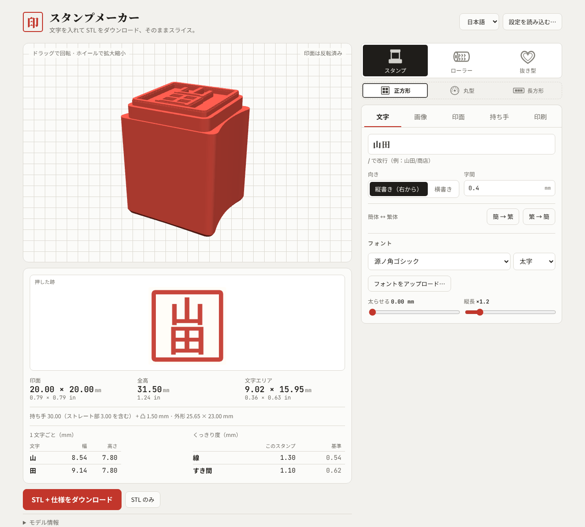
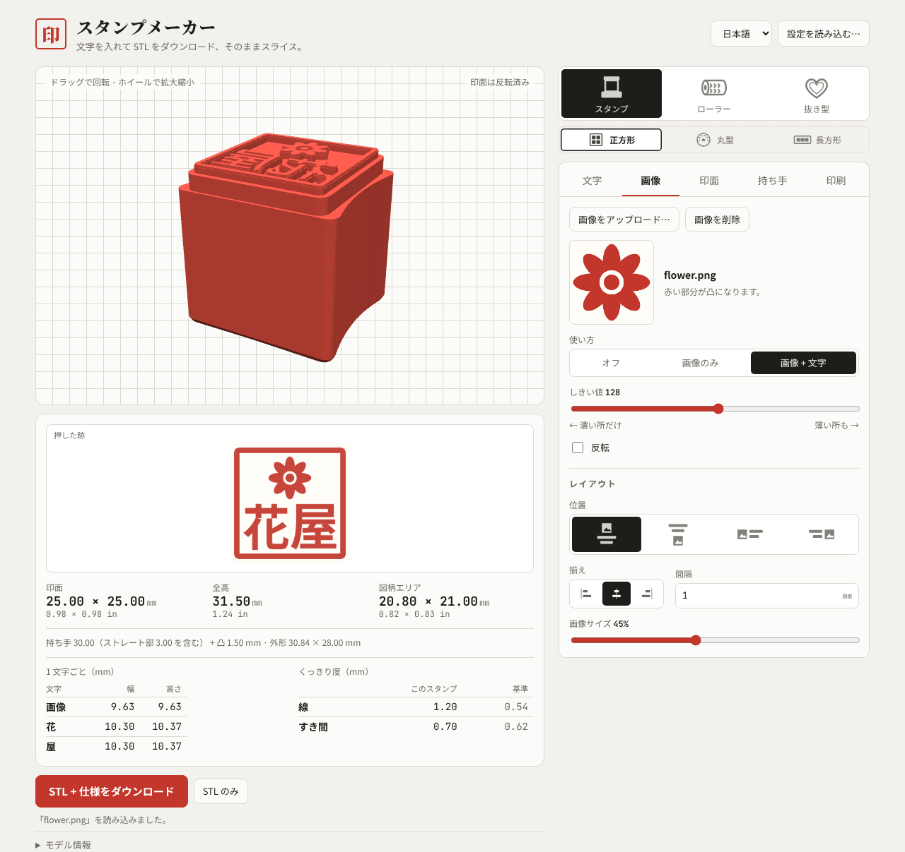
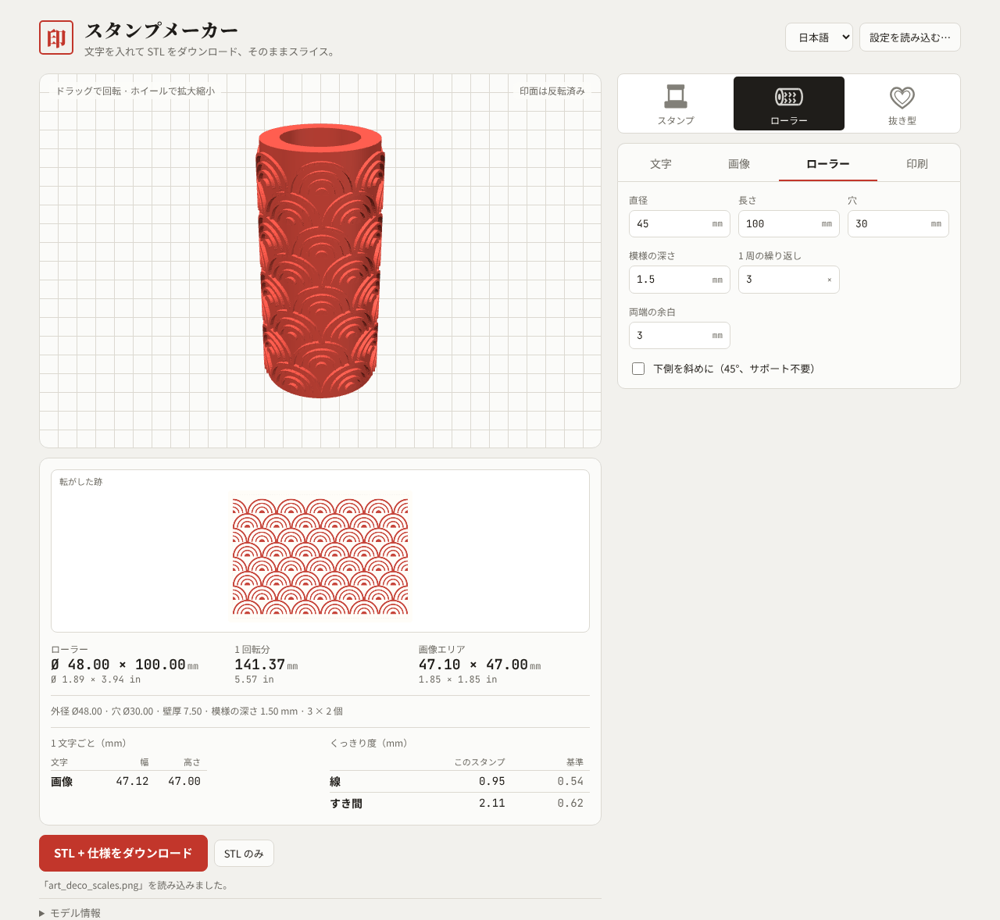
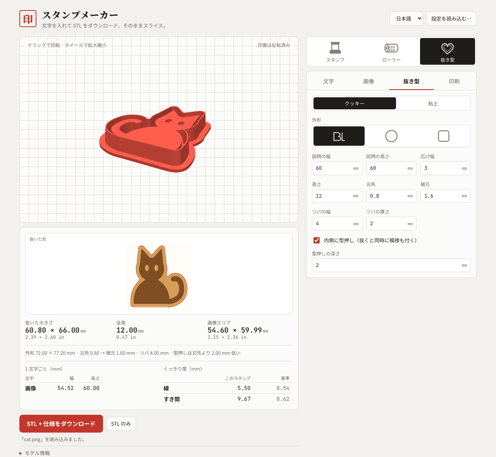
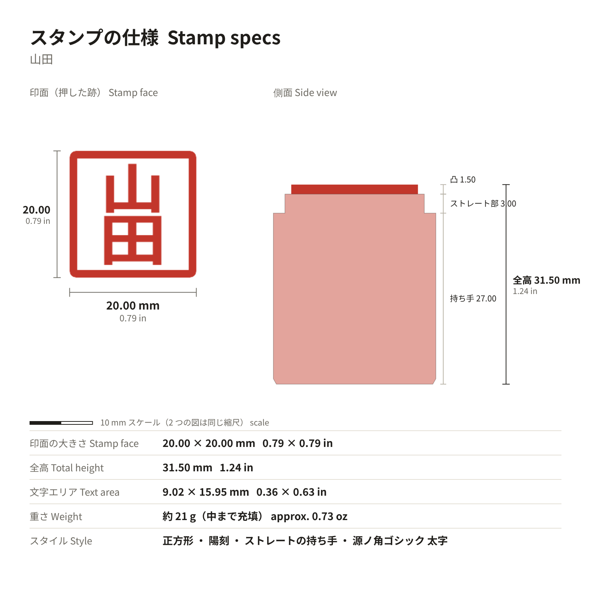

# スタンプメーカー · Stamp Maker

[中文](README.md) · [English](README.en.md) · **日本語** · [한국어](README.ko.md)

文字を入力するか画像をアップロードするだけで、3D プリントできる **スタンプ、エンボスローラー、クッキー / 粘土用の抜き型** の STL を作れます。寸法は 0.01 mm 単位（インチ併記）で、仕様カードも付きます。モデリングソフトは不要。ダウンロードしてスライサーに入れるだけです。

**開き方：** このリポジトリの GitHub Pages のリンク（Settings → Pages に表示されます）を開くか、`index.html` をダウンロードしてブラウザで開きます。右上で言語（中文 / English / 日本語 / 한국어）を切り替えられます。

## 3 ステップでスタンプを作る

1. **種類と形を選ぶ**：一番上の行でスタンプ・ローラー・抜き型を選びます。スタンプなら、その下で正方形・丸型・長方形を選びます。
2. **文字を入力するか画像をアップロード**：「文字」タブで入力し（`/` で改行。例：`山田/商店`）、フォントを選びます。または「画像」タブでロゴをアップロードします。3D と「押した跡」のプレビューがすぐに更新されます。
3. **確認してダウンロード**：細すぎて印刷できない線は黄色、小さすぎる囲まれたすき間は青で表示されます。**自動調整** で直せます。寸法を確認して **STL + 仕様をダウンロード** を押します。

## 画像 + 文字

PNG・JPG・SVG をアップロードして、画像だけでも文字と組み合わせても使えます。画像を上・下・左・右に置き、揃え・間隔・画像サイズを調整できます。白黒がはっきりしたロゴやシルエットが最適です。

## エンボスローラー

文字や模様が一周ぐるりと並ぶ中空のローラーです。シームレスな模様は行単位で並び、途中で切れることはありません。直径・長さ・穴・模様の深さ・1 周の繰り返し数を設定できます。立てて印刷します。

## 抜き型（クッキー / 粘土イヤリング）

外形は図柄に沿わせるか、円・四角にできます。クッキー用と粘土用のサイズはワンクリックで切り替え。**内側に型押し** にチェックすると、1 回押すだけで抜きと模様付けが同時にできます。ツバを下にして印刷し、サポートは不要です。

## ダウンロードされるもの

**STL + 仕様をダウンロード** で zip が保存されます。中身は STL、仕様カード（印面と側面を同じ縮尺で、mm とインチ、10 mm スケール付き）、商品ページにそのまま貼れる英文入りの仕様書、そして **設定を読み込む** で復元できる設定ファイルです。

## 主な機能

- **スタンプ**：正方形・丸型（文字をリング状に配置）・長方形。陽刻 / 陰刻。一体型のストレートな持ち手、指の溝も追加可能
- **フォント**：中国語（簡体・繁体）、英語、日本語、韓国語。自分のフォントもアップロード可能。足りない文字は警告
- **印刷前チェック**：細い線は黄色、小さなすき間は青、自動調整。範囲外の数値は理由を表示
- **Bambu Studio**：A1 のプロセスプロファイルを選ぶと、何層にスライスされるか、凸部の実際の高さがわかります
- **寸法**：外形・全高・図柄エリア・1 文字ごとの幅 × 高さを 0.01 mm 単位で

## 印刷のコツ

- スタンプは印面を上、ローラーは立てて、抜き型はツバを下にして印刷します。どれも通常サポートは不要です
- 小さなスタンプに英字を入れる場合、Cinzel や Playfair の細いセリフはノズルより細くなることがあります。Roboto Slab や Bebas Neue のほうが安定します

## コードを変更する

ソースは `src/`（`head.html` スタイル、`body.html` レイアウト、`app.js` ロジック、`geo.js` メッシュ）にあります。変更後に `python3 build.py` を実行して `index.html` を作り直します。テストは `docs/测试计划.md` と `tests/` にあります。ライブラリは CDN から読み込みます：three.js、earcut、opencc-js、Google Fonts。

## ライセンス

[PolyForm Noncommercial 1.0.0](LICENSE) で公開しています。**個人利用などの非商用利用は無料** で、変更や共有もできます。**商用利用には別途ライセンスが必要です**（このツールで作ったスタンプ・ローラー・抜き型の販売、有料の製品やサービスへの組み込みなど）。商用ライセンスについては GitHub の [gracege17](https://github.com/gracege17) までご連絡ください。

ライセンスの正式な条文は英語版です。この説明は参考用です。

Copyright (c) 2026 gracege17 · サードパーティ：three.js (MIT)、earcut (ISC)、opencc-js (Apache-2.0)。フォントは Google Fonts（SIL Open Font License）。
