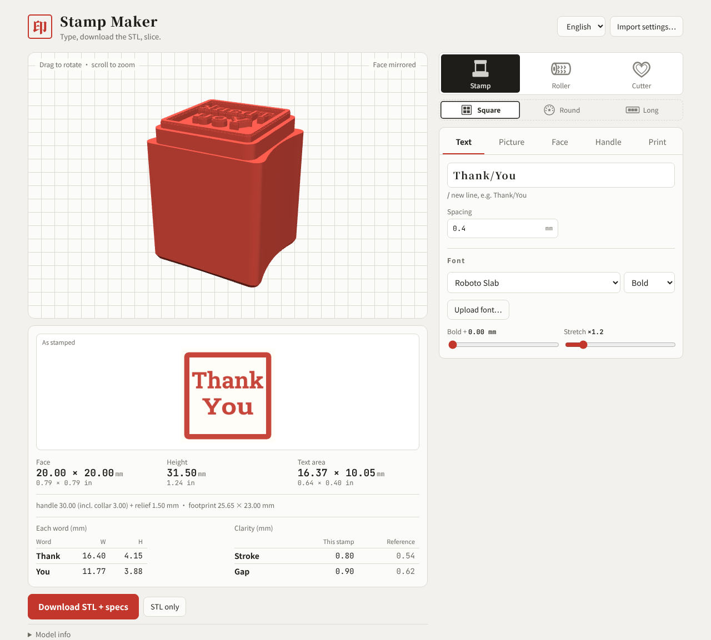
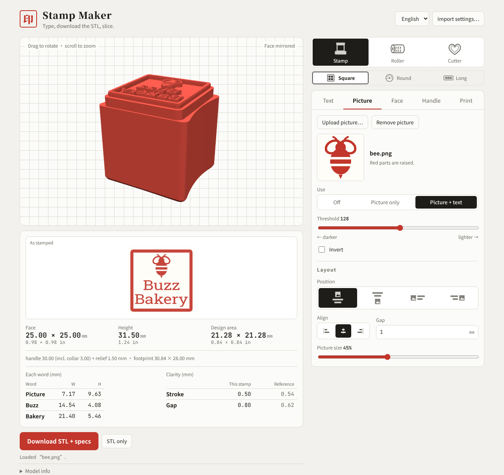
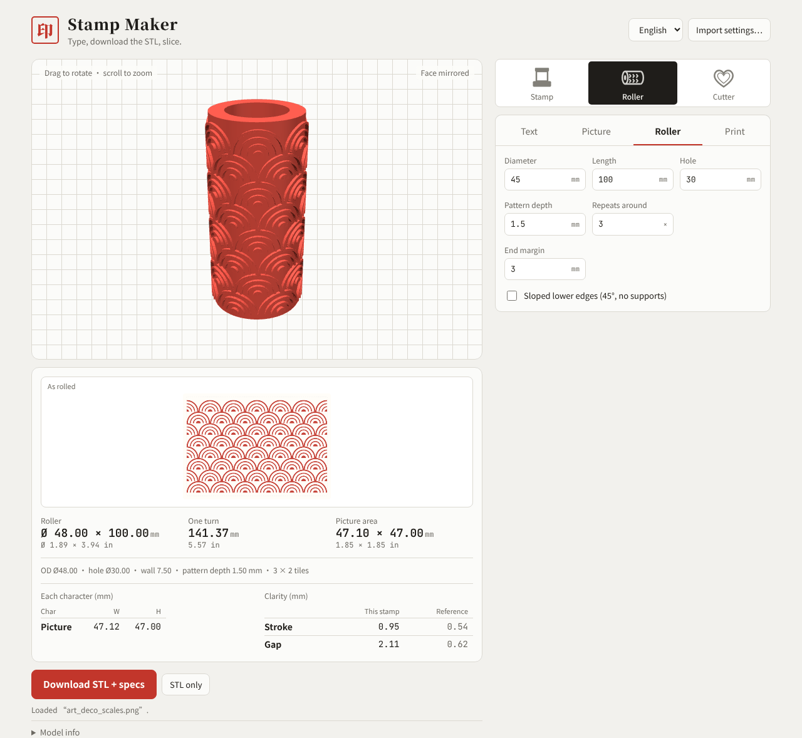
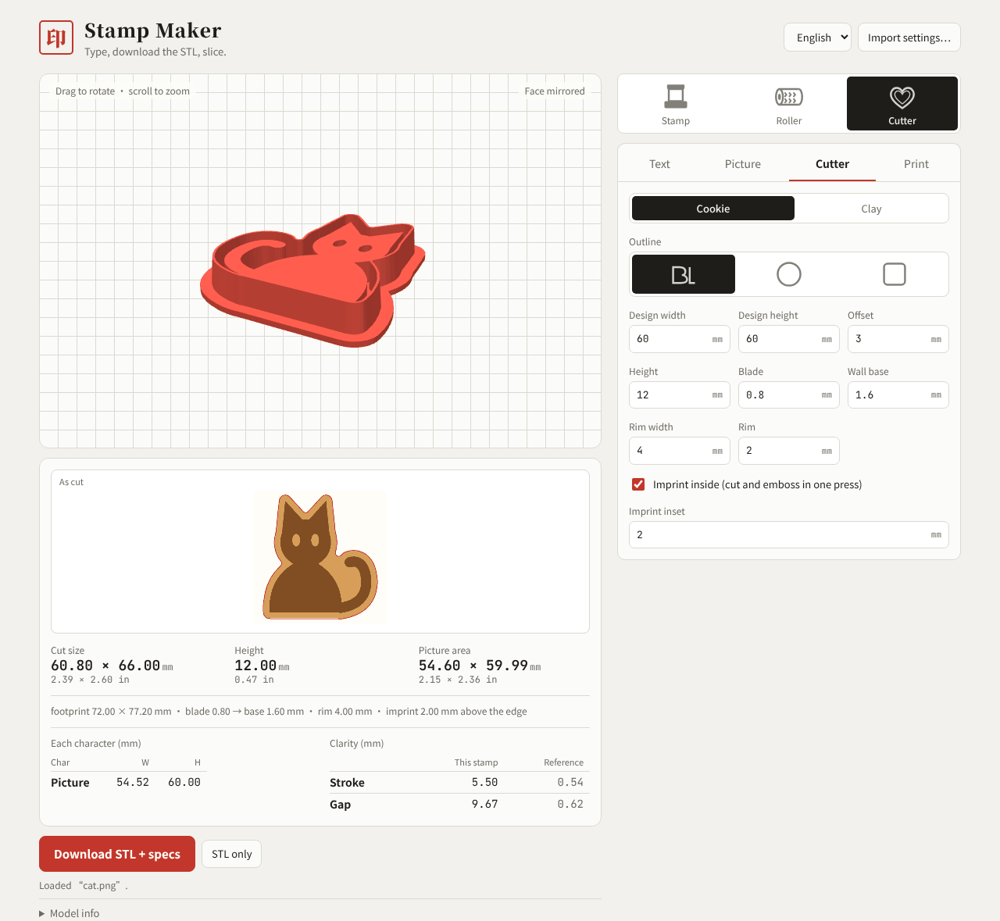
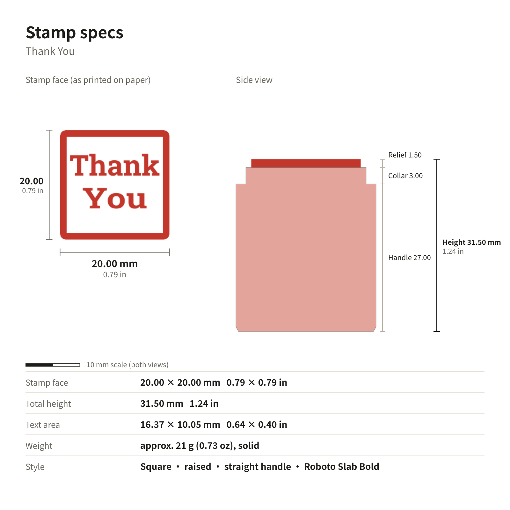

# Stamp Maker · 印章打印器

**English** · [中文](docs/readme/README.zh.md) · [日本語](docs/readme/README.ja.md) · [한국어](docs/readme/README.ko.md)

Type some text or upload a picture and get a 3D-printable STL for a **stamp, an embossing roller or a cookie / clay cutter**, with sizes to 0.01 mm (plus inches) and a spec card. No modelling software needed: download the file and drop it into your slicer.

**How to open it:** use this repository's GitHub Pages link (shown under Settings → Pages), or download `index.html` and open it in a browser. Pick the language (中文 / English / 日本語 / 한국어) at the top right.

## Make a stamp in three steps

1. **Pick a category and shape**: choose Stamp, Roller or Cutter in the top row; for a stamp, pick square, round or long underneath.
2. **Type text or upload a picture**: type on the Text tab (use `/` for a new line, e.g. `Thank/You`) and choose a font, or upload a logo on the Picture tab. The 3D view and the "As stamped" preview update right away.
3. **Check and download**: strokes too thin to print are marked yellow and tiny enclosed spaces blue; **Auto-fix** can repair them. Check the sizes and click **Download STL + specs**.

## Picture + text

Upload a PNG, JPG or SVG and use it on its own or with text: put the picture above, below, left or right, and adjust alignment, gap and picture size. Clean black-and-white logos and silhouettes work best.

## Embossing roller

A hollow roller with your text or pattern repeated all the way round. Seamless patterns tile in whole rows, never cut in half. Set the diameter, length, hole, pattern depth and how many repeats go round. Prints standing up.

## Cutter (cookies / clay earrings)

The outline can follow your design, or be a circle or square. Switch between Cookie and Clay sizes with one click. Tick **Imprint inside** to cut and emboss in one press. Prints rim down with no supports.

## What you download

**Download STL + specs** gives you a zip with the STL, a spec card (face and side view to the same scale, mm and inches, with a 10 mm scale bar), a text spec sheet with a paragraph ready for a product listing, and a settings file you can load again with **Import settings**.

## Features

- **Stamps**: square, round (text around the ring) and long; raised or engraved; one-piece straight handle with optional finger grips
- **Fonts**: Chinese (Simplified and Traditional), English, Japanese and Korean, or upload your own; missing characters are flagged
- **Print checks**: thin strokes in yellow, tiny spaces in blue, Auto-fix; out-of-range numbers are explained
- **Bambu Studio**: pick an A1 process profile to see how many layers it slices into and the real relief height
- **Sizes**: footprint, height, design area and each character's width × height, to 0.01 mm

## Printing tips

- Print stamps face up, rollers standing up and cutters rim down; none of them normally need supports
- On small English stamps the thin serifs of Cinzel or Playfair can be thinner than the nozzle; Roboto Slab or Bebas Neue print more reliably

## Changing the code

Source is in `src/` (`head.html` styles, `body.html` layout, `app.js` logic, `geo.js` meshes). Run `python3 build.py` afterwards to rebuild `index.html`. Tests are described in `docs/测试计划.md` and live in `tests/`. Libraries load from CDNs: three.js, earcut, opencc-js and Google Fonts.

## License

Licensed under [PolyForm Noncommercial 1.0.0](LICENSE): **free for personal and other noncommercial use**, including changing and sharing it. **Commercial use requires a separate license**, for example selling stamps, rollers or cutters made with it, or using it in a paid product or service. For a commercial license, contact [gracege17](https://github.com/gracege17) on GitHub.

Copyright (c) 2026 gracege17 · Third-party: three.js (MIT), earcut (ISC), opencc-js (Apache-2.0); fonts from Google Fonts (SIL Open Font License).
