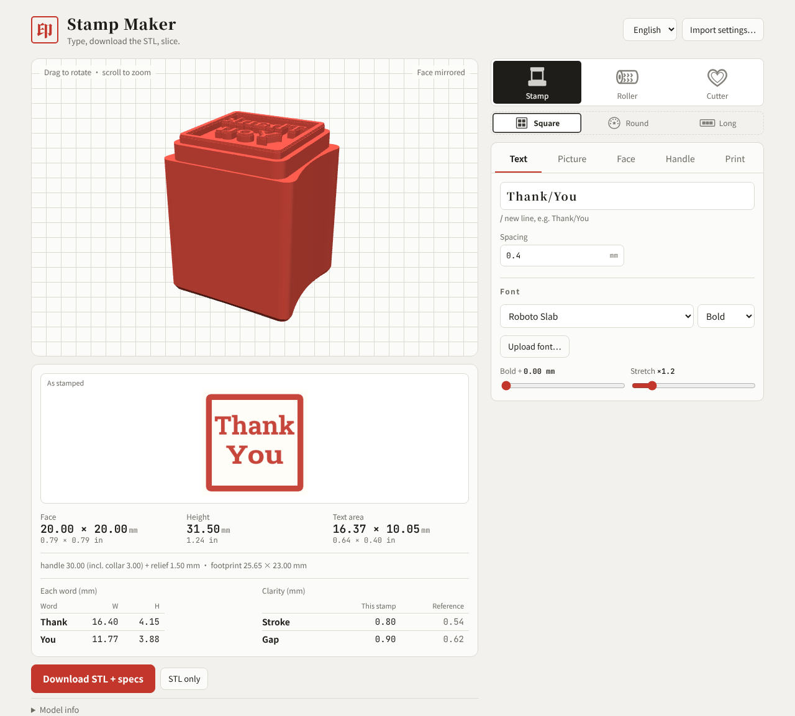
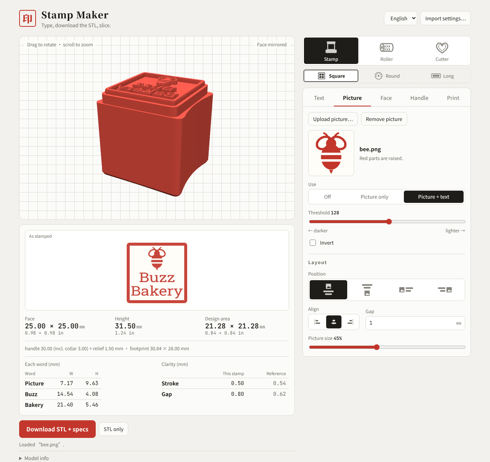
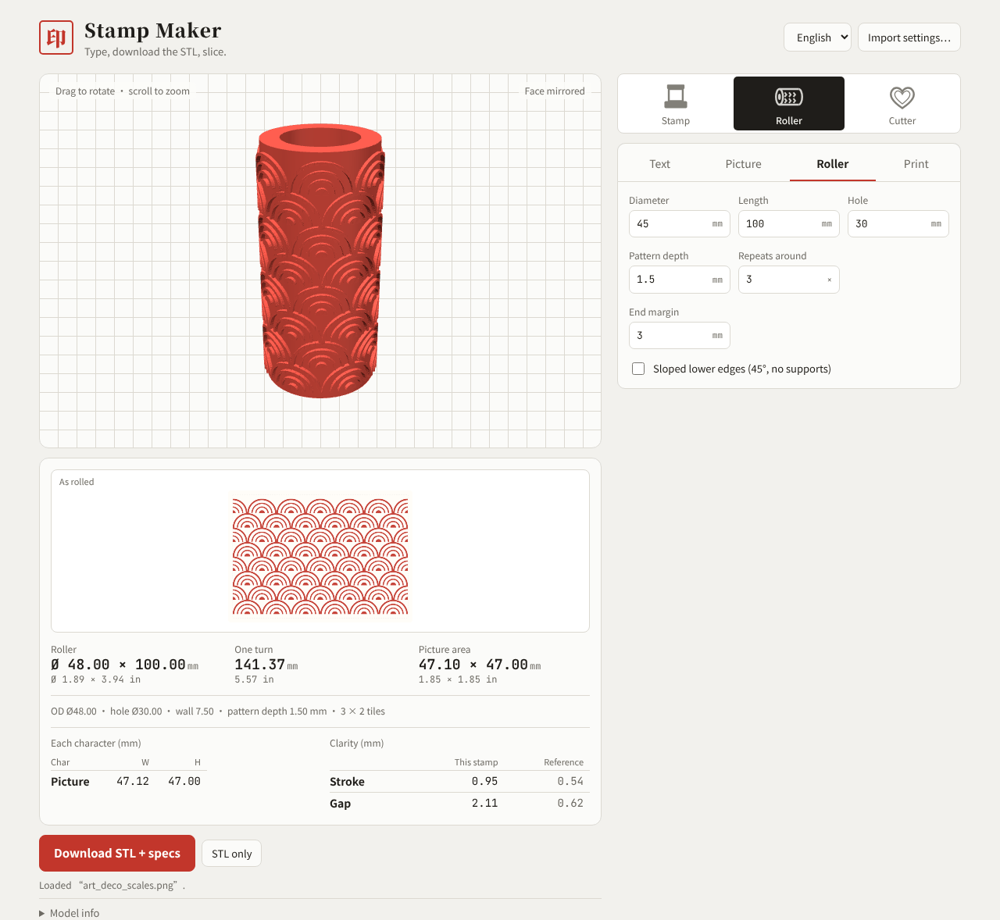
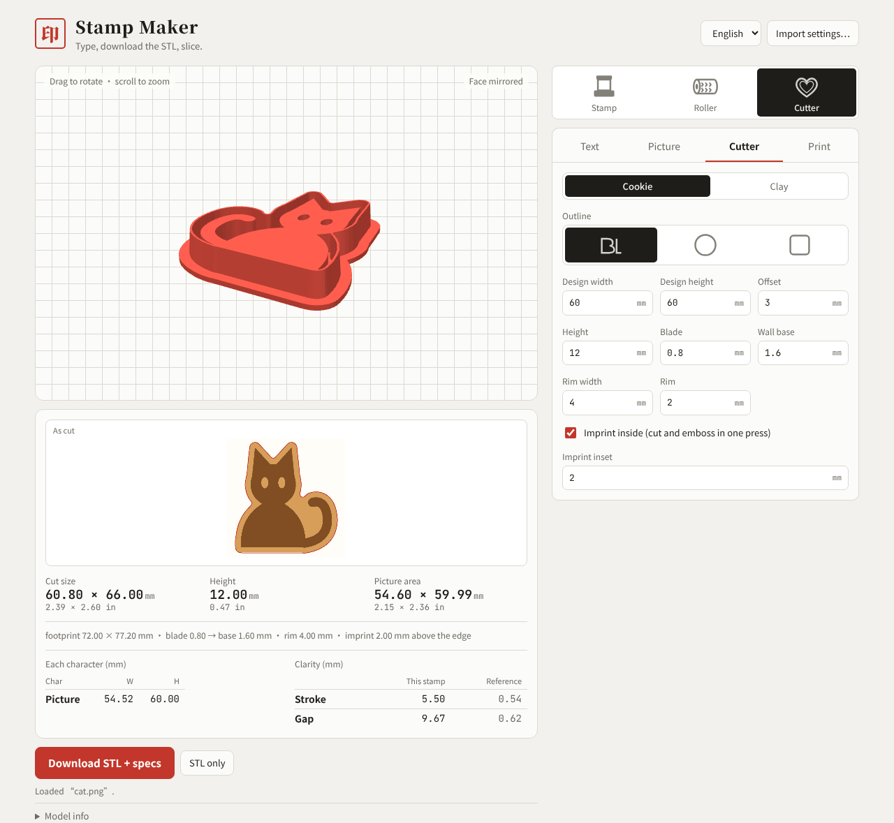
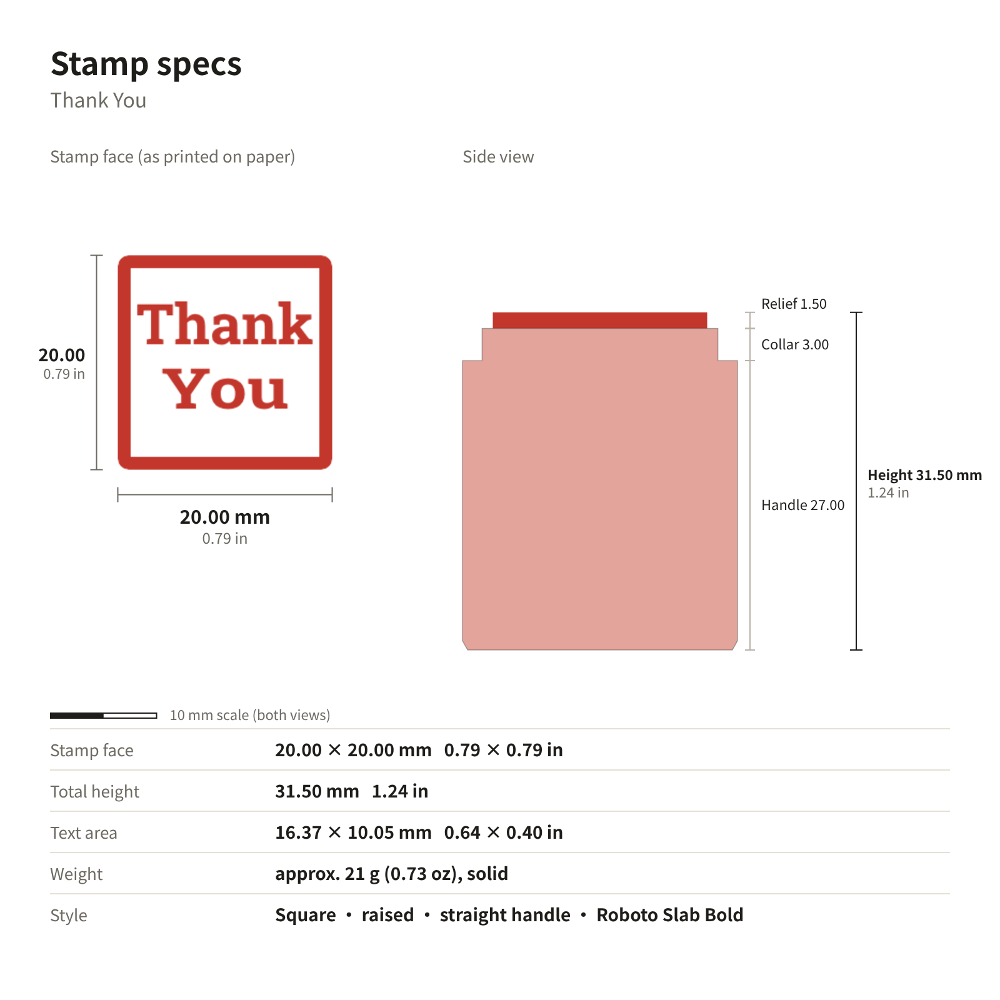

# 스탬프 메이커 · Stamp Maker

[English](../../README.md) · [中文](README.zh.md) · [日本語](README.ja.md) · **한국어**

글자를 입력하거나 이미지를 올리면 3D 프린팅용 **스탬프, 엠보싱 롤러, 쿠키 / 점토 커터** STL을 바로 만들어 줍니다. 치수는 0.01 mm 단위(인치 함께 표시)이고 사양 카드도 함께 나옵니다. 모델링 프로그램은 필요 없습니다. 파일을 받아 슬라이서에 넣기만 하면 됩니다.

(스크린샷은 영어 화면입니다. 오른쪽 위에서 한국어로 바꿀 수 있습니다.)

**여는 방법:** 이 저장소의 GitHub Pages 링크(Settings → Pages에서 확인)를 열거나, `index.html`을 내려받아 브라우저로 엽니다. 오른쪽 위에서 언어(中文 / English / 日本語 / 한국어)를 바꿀 수 있습니다.

## 세 단계로 스탬프 만들기

1. **종류와 모양 고르기**: 맨 위 줄에서 스탬프, 롤러, 커터 중 하나를 고릅니다. 스탬프라면 그 아래에서 정사각형, 원형, 직사각형을 고릅니다.
2. **글자 입력 또는 이미지 올리기**: ‘글자’ 탭에서 입력하고(`/`로 줄바꿈, 예: `감사/합니다`) 글꼴을 고릅니다. 또는 ‘이미지’ 탭에서 로고를 올립니다. 3D와 ‘찍힌 모양’ 미리보기가 바로 바뀝니다.
3. **확인하고 다운로드**: 출력하기에 너무 가는 획은 노랑, 너무 작은 빈 곳은 파랑으로 표시됩니다. **자동 조정**으로 고칠 수 있습니다. 치수를 확인한 뒤 **STL + 사양 다운로드**를 누릅니다.

## 이미지 + 글자

PNG, JPG, SVG를 올려 이미지만 쓰거나 글자와 함께 배치할 수 있습니다. 이미지를 위, 아래, 왼쪽, 오른쪽에 두고 정렬, 간격, 이미지 크기를 조정합니다. 흑백이 뚜렷한 로고나 실루엣이 가장 좋습니다.

## 엠보싱 롤러

글자나 무늬가 한 바퀴 빙 둘러 반복되는 속이 빈 롤러입니다. 이음매 없는 무늬는 줄 단위로 채워져 반쪽으로 잘리지 않습니다. 지름, 길이, 구멍, 무늬 깊이, 둘레 반복 수를 정할 수 있습니다. 세워서 출력합니다.

## 커터(쿠키 / 점토 귀걸이)

외형은 디자인을 따라가거나 원, 사각으로 할 수 있습니다. 쿠키용과 점토용 크기는 클릭 한 번으로 바뀝니다. **안쪽 압인**을 체크하면 한 번 눌러서 자르기와 무늬 찍기를 동시에 합니다. 받침을 아래로 해서 출력하며 서포트가 필요 없습니다.

## 다운로드되는 것

**STL + 사양 다운로드**를 누르면 zip 파일이 저장됩니다. STL, 사양 카드(인면과 측면을 같은 비율로, mm와 인치, 10 mm 축척 포함), 상품 페이지에 바로 붙여 넣을 영어 문단이 들어 있는 사양서, 그리고 **설정 불러오기**로 다시 열 수 있는 설정 파일이 들어 있습니다.

## 주요 기능

- **스탬프**: 정사각형, 원형(글자를 둥글게 배치), 직사각형. 양각 / 음각. 일체형 일자 손잡이, 손가락 홈 추가 가능
- **글꼴**: 중국어(간체, 번체), 영어, 일본어, 한국어. 직접 글꼴을 올릴 수도 있고, 없는 글자는 알려 줍니다
- **출력 전 점검**: 가는 획은 노랑, 작은 빈 곳은 파랑, 자동 조정. 범위를 벗어난 숫자는 이유를 알려 줍니다
- **Bambu Studio**: A1 프로세스 프로파일을 고르면 몇 층으로 슬라이스되는지, 돌출부의 실제 높이가 얼마인지 보여 줍니다
- **치수**: 외형, 전체 높이, 디자인 영역, 글자별 폭 × 높이를 0.01 mm 단위로

## 출력 팁

- 스탬프는 인면을 위로, 롤러는 세워서, 커터는 받침을 아래로 해서 출력합니다. 보통 모두 서포트가 필요 없습니다
- 작은 스탬프에 영문을 넣을 때 Cinzel이나 Playfair의 가는 세리프는 노즐보다 가늘어질 수 있습니다. Roboto Slab이나 Bebas Neue가 더 안정적입니다

## 코드 수정

소스는 `src/`(`head.html` 스타일, `body.html` 레이아웃, `app.js` 로직, `geo.js` 메시)에 있습니다. 수정한 뒤 `python3 build.py`를 실행해 `index.html`을 다시 만듭니다. 테스트는 `docs/测试计划.md`와 `tests/`에 있습니다. 라이브러리는 CDN에서 불러옵니다: three.js, earcut, opencc-js, Google Fonts.

## 라이선스

[PolyForm Noncommercial 1.0.0](../../LICENSE)으로 공개합니다. **개인 용도 등 비상업적 사용은 무료**이며 수정과 공유도 할 수 있습니다. **상업적 사용에는 별도 라이선스가 필요합니다**(이 도구로 만든 스탬프, 롤러, 커터 판매, 유료 제품이나 서비스에 포함 등). 상업 라이선스는 GitHub의 [gracege17](https://github.com/gracege17)에게 문의하세요.

라이선스의 정식 조문은 영문판이며, 이 설명은 참고용입니다.

Copyright (c) 2026 gracege17 · 서드파티: three.js (MIT), earcut (ISC), opencc-js (Apache-2.0). 글꼴은 Google Fonts(SIL Open Font License).
