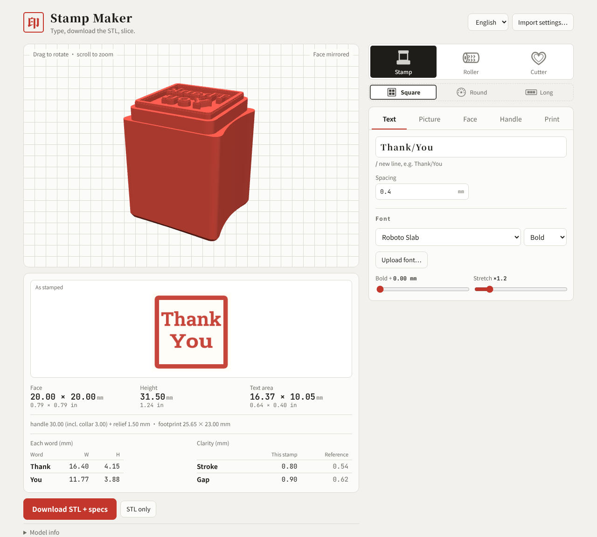
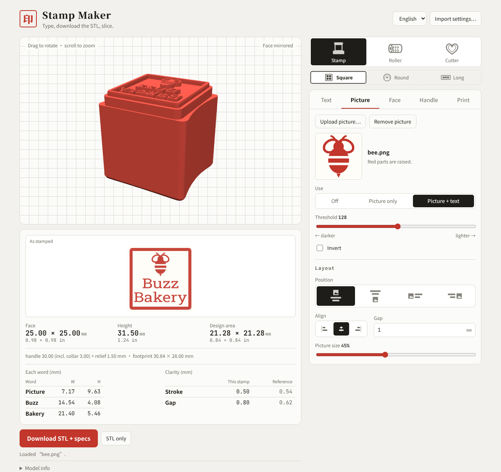
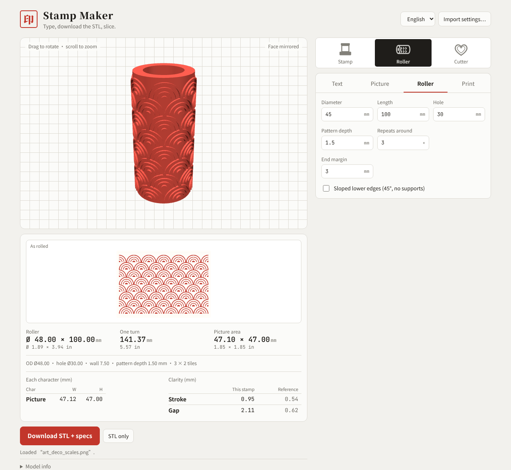
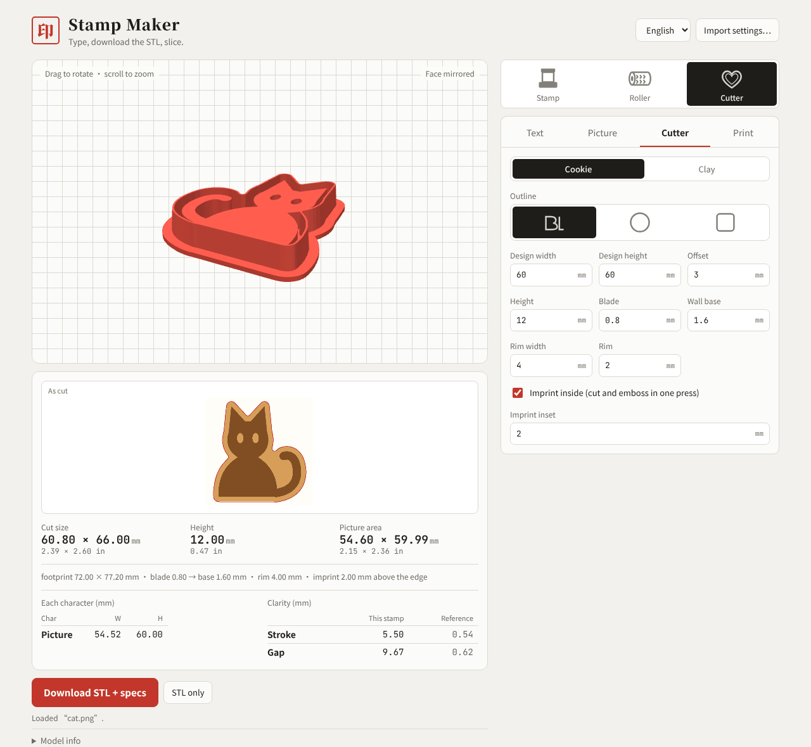
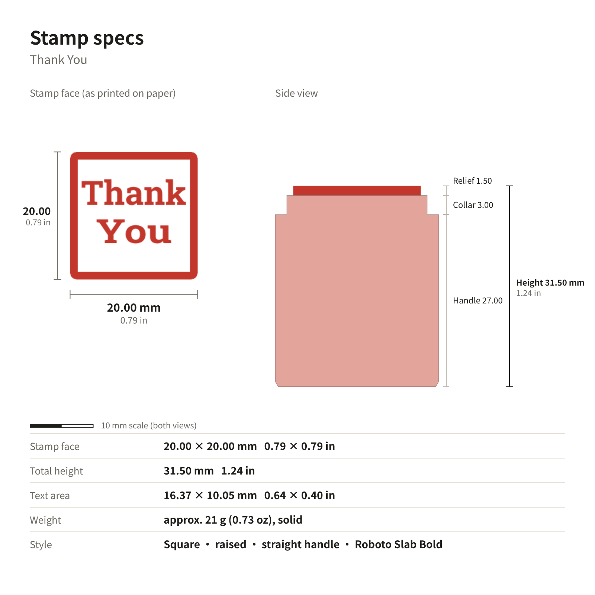

# 印章打印器 · Stamp Maker

[English](../../README.md) · **中文** · [日本語](README.ja.md) · [한국어](README.ko.md)

输入文字或上传图案，直接生成可以 3D 打印的 **印章、滚轮压花、饼干 / 黏土切模** 的 STL，同时给出精确到 0.01 mm 的尺寸（附英寸）和规格卡。不用建模软件，下载后拖进切片软件就能打。

（截图是英文界面，打开后右上角可以切换成中文。）

**怎么打开：** 打开本仓库的 GitHub Pages 地址（Settings → Pages 里能看到）；或者下载 `index.html`，用浏览器直接打开。界面右上角可以切换语言（中文 / English / 日本語 / 한국어）。

## 三步做一个章

1. **选类别和形状**：最上面一排选「印章 / 滚轮 / 切模」；印章下面再选方章、圆章或长条章。
2. **输入文字或上传图案**：在「文字」页输入（用 `/` 换行，如 `陈氏/之印`），选字体；或者在「图案」页上传 logo。左边的 3D 和「盖出来的效果」会马上更新。
3. **检查、下载**：笔画太细的地方会标黄、太小的空格标蓝，点「一键调整」可以自动修。确认尺寸后点「下载 STL + 规格」。

## 图案 + 文字

上传 PNG / JPG / SVG 后，可以只用图案，也可以和文字一起排版：图在上、下、左、右，对齐、间距、图案大小都能调。黑白分明的 logo 和剪影效果最好。

## 滚轮压花

空心圆筒滚轮，文字或图案一圈一圈铺满。上传无缝图案时会自动整排铺满，不会切掉半个。可调直径、长度、内孔、花纹深和每圈重复次数。竖着打。

## 切模（饼干 / 黏土耳环）

外形可以跟随图案，也可以是圆形或方形。「饼干 / 黏土」一键切换尺寸。勾「内部压纹」，一压同时切形和压花。边沿贴平台打，不用支撑。

## 下载的内容

「下载 STL + 规格」会打包：STL、规格卡图片（印面和侧面同比例，mm / 英寸，附 10 mm 比例尺）、规格说明（含可直接贴到商品页的英文段落）、设置文件（以后「导入设置」能还原）。

## 功能一览

- **印章**：方章、圆章（环形排字）、长条章；阳文 / 阴文；一体直筒手柄，可加手指凹槽
- **字体**：中文简繁、英文、日文、韩文，也能上传自己的字体；缺字会提示；一键简繁转换
- **打印前检查**：细笔画标黄、小空格标蓝、一键调整；数字超出安全范围会提示
- **Bambu Studio**：选 A1 的工艺配置，显示会切成几层、字凸起实际多高
- **尺寸**：外形、总高、文字区域、每个字的宽 × 高，到 0.01 mm

## 打印建议

- 印章印面朝上、滚轮竖着、切模边沿贴平台打，一般都不用支撑
- 小章用英文时，Cinzel / Playfair 的细衬线容易细过喷嘴，Roboto Slab 或 Bebas Neue 更稳

## 修改代码

源码在 `src/`（`head.html` 样式、`body.html` 结构、`app.js` 逻辑、`geo.js` 网格），改完运行 `python3 build.py` 生成 `index.html`。测试见 `docs/测试计划.md` 和 `tests/`。外部依赖从 CDN 加载：three.js、earcut、opencc-js、Google Fonts。

## 许可证

本项目使用 [PolyForm Noncommercial 1.0.0](../../LICENSE)：**个人和非商业用途免费**，可以使用、修改、分享。**商业用途需要另行授权**，比如用它做印章、滚轮、切模来卖，或者放进收费的产品或服务里。商用授权请通过 GitHub 联系 [gracege17](https://github.com/gracege17)。

Copyright (c) 2026 gracege17 · 第三方组件：three.js (MIT)、earcut (ISC)、opencc-js (Apache-2.0)；字体来自 Google Fonts（SIL Open Font License）。
